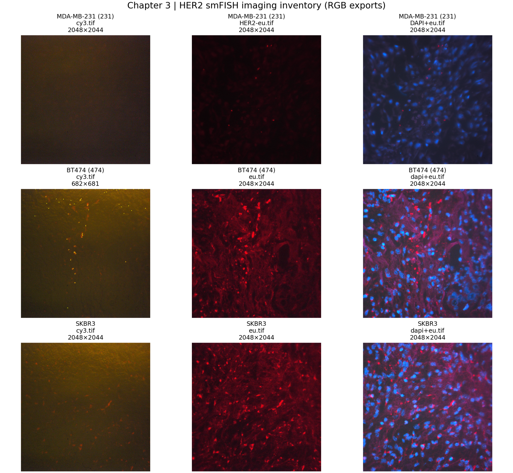
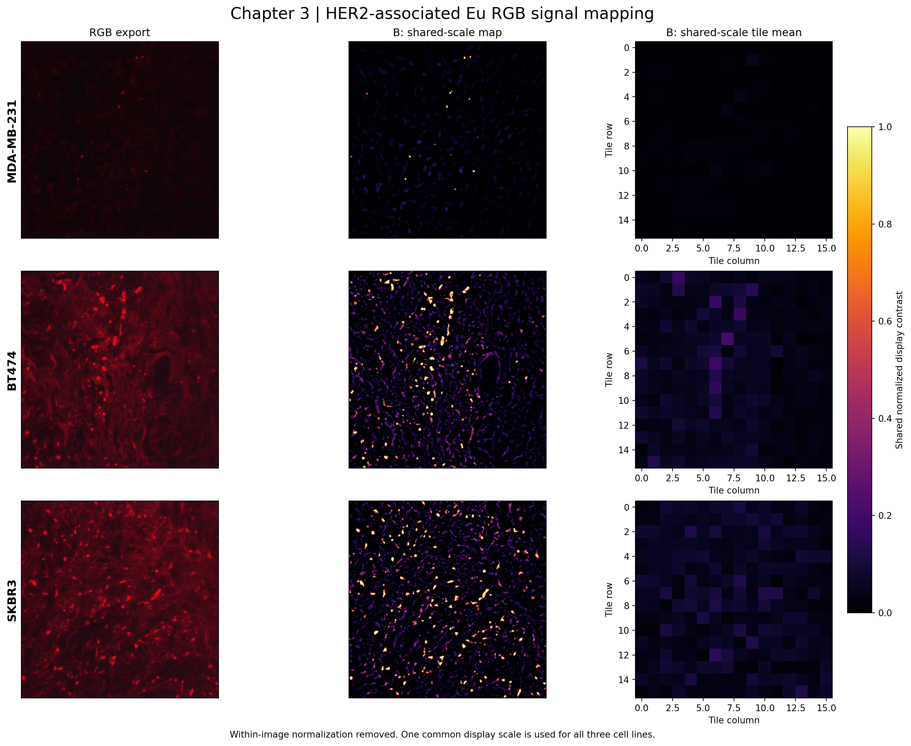
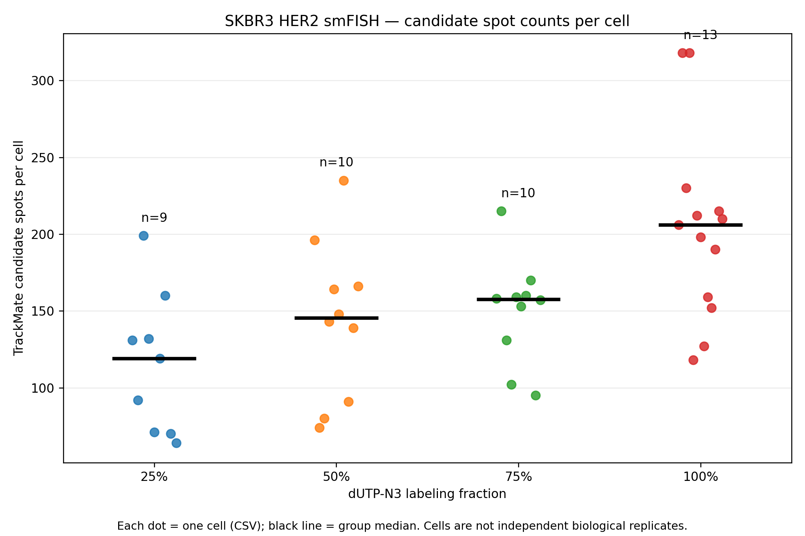
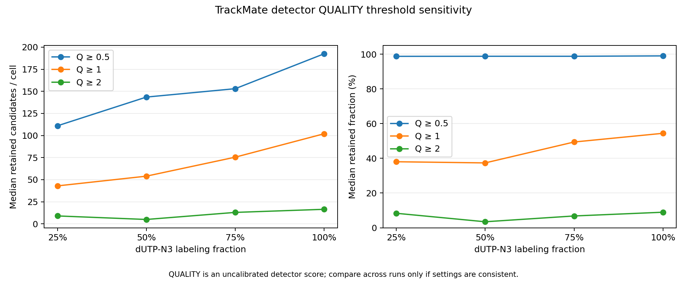

# Lanthanide smFISH | Computational Imaging Analysis

**Exploratory microscopy visualization and reproducible single-cell spot-count auditing for HER2 smFISH.**

This repository is a **post-publication computational extension** associated with:

> **Lanthanide Complex for Single-Molecule Fluorescent In Situ Hybridization and Background-Free Imaging**  
> *Analytical Chemistry* (2024).  
> DOI: https://doi.org/10.1021/acs.analchem.3c04530

The work combines experimental molecular imaging, microscopy QC, Python image processing, and data provenance checks. **These scripts and derived figures are not represented as algorithms or results included in the original publication.**

## Overview

| Module | Source | Output | Interpretation |
|---|---|---|---|
| **Three-cell-line HER2-associated signal maps** | MDA-MB-231, BT474, SKBR3 Eu RGB-exported TIFFs | Three-row RGB / shared-scale local-contrast / tile-mean overview | Exploratory spatial visualization of **display-encoded** Eu signal; **not** absolute mRNA expression |
| **SKBR3 single-cell spot count audit** | TrackMate CSV exports from 25%, 50%, 75%, and 100% dUTP-N3 conditions | Per-cell dots, group median, mean, sample variance, audit CSV | A file `<gradient>-<number>.csv` = **one experimentally defined cell**; spot detections are candidates |
| **Detection quality sensitivity** | TrackMate `QUALITY` scores from the same CSVs | Threshold-retention plots, exclusion audit | Detector-score sensitivity; not calibrated optical SNR |
| **Optional ImageJ vs TrackMate comparison** | Verified **same-cell** ImageJ count CSV (not supplied) | Paired count/difference plots | No paired comparison is claimed until same-cell ImageJ data exist |

## Real-data image inventory

The following is a channel-and-file inventory from nine existing RGB TIFF exports, not a validated quantitative expression comparison:



## Reproduced figures

After running `scripts/run_all.sh`, the generated figures are placed here:

**Three cell lines: one shared display scale (local red-channel contrast)**



**SKBR3: candidate spots per experimentally defined cell**



**TrackMate quality-threshold sensitivity**



> **Important:** Sharing a display scale does not make TIFF values calibrated or cross-experimentally comparable. The MDA-MB-231 map is not artificially set to be weaker. Any observed ordering may reflect acquisition/rendering differences.

## Repository structure

```text
Lanthanide-smFISH-Computational-Analysis/
├── README.md
├── README_CN.md
├── requirements.txt
├── imaging_maps/
│   ├── her2_threecell_preview.py
│   └── chapter3_mrna_heatmap_global_only.py
├── spot_counts/
│   ├── chapter3_spot_scatter_stats.py
│   └── method_robustness.py
├── scripts/
│   └── run_all.sh
├── examples/
│   └── imagej_per_cell_TEMPLATE.csv
├── figures/
│   └── three_cell_line_overview.png
└── tests/
```

`figures/` receives three additional derived figures when `run_all.sh` is executed against the private real inputs. The large original TIFFs and raw per-cell CSVs are **not** distributed in this repository.

## Installation

Tested in a Python environment with NumPy, SciPy, Matplotlib, and tifffile. TIFF decoding of some microscopy exports requires `imagecodecs`.

```bash
python -m pip install -r requirements.txt
python -m pytest -q tests/
```

## Reproduce the analysis from private experimental data

Point these variables at your local files. Quote paths because they may contain spaces or non-ASCII characters.

```bash
GRADIENT_DATA='/path/to/fig3 0710'
MAPPING_DATA="$GRADIENT_DATA/Her2 mRNA mapping"

bash scripts/run_all.sh "$GRADIENT_DATA" "$MAPPING_DATA"
```

This produces:

- `figures/her2_shared_scale_map.png`
- `figures/trackmate_spots_per_cell.png`
- `figures/trackmate_quality_sensitivity.png`
- `outputs/mapping/analysis_summary.csv`
- `outputs/spot_counts/gradient_summary.csv` and `file_audit.csv`
- `outputs/trackmate_robustness/trackmate_cell_audit.csv` and `interpretation.txt`

`outputs/` is ignored by Git; review curated figures before committing them.

**Optional: inventory of all nine images**

```bash
python imaging_maps/her2_threecell_preview.py \
  --root "$MAPPING_DATA" --out outputs/image_inventory
```

**Optional: genuine matched ImageJ results only**

```bash
python spot_counts/method_robustness.py \
  --root "$GRADIENT_DATA" \
  --imagej /path/to/verified_same_cell_imagej_counts.csv \
  --out outputs/paired_methods
```

The ImageJ file must contain columns `gradient,cell_id,imagej_spots`, and every row must correspond to **the same cell and image/ROI** as its TrackMate counterpart. The template is deliberately empty.

## Methods and scope

### Eu-associated local display contrast

For each RGB export, the red channel is processed using two Gaussian scales, followed by zero-clipping:

\[ C(x,y)=\max\bigl(0,G_{\sigma=2}(R)(x,y)-G_{\sigma=20}(R)(x,y)\bigr). \]

One common 99.5th-percentile scale (pooled across all three candidate images) is applied for **display only**. The output additionally includes 128-pixel tile means. A local-contrast response can emphasize elongated or structural features and should **not** be interpreted as a validated single-molecule spot map.

### Per-cell TrackMate counts

The TrackMate spot CSV parser reads the exported `ID`, `QUALITY`, `POSITION_X`, `POSITION_Y` columns, ignores blank/footer rows, and excludes files with inconsistent filename vs folder gradient. **No 25%/50% label swapping is performed.** Files with malformed real spot rows or other validation issues are excluded and documented. Summary statistics are descriptive: median, mean, sample variance and dispersion, with each CSV considered one cell.

## Scientific limitations

- RGB TIFFs may be processed displays (8-bit, pseudocolor), rather than calibrated raw luminescence.
- There is no established cross-cell-line calibration of illumination, acquisition settings, gain, LUT, staining, or specimen area.
- The Eu red display channel is a working assumption to verify against acquisition records.
- Neither shared-scale color maps nor brighter local patterns establish HER2 transcript abundance, HER2-positive cell identity, or time-gating causality.
- Candidate TrackMate spots are **not** individually validated single HER2 transcripts; the `QUALITY` score is detector-dependent.
- Several historical files have filename/folder gradient conflicts and must be manually reviewed, not silently reclassified.
- Cells within one experiment are **not independent biological replicates**. No inferential p-values are reported.
- Published ImageJ-based measurements and the TrackMate exports can differ. Algorithm-specific outcomes should not be adjusted to match the published trend.
- Confirm that any included microscopy figures have been approved for public distribution.

## Citation

*Lanthanide Complex for Single-Molecule Fluorescent In Situ Hybridization and Background-Free Imaging*. **Analytical Chemistry** (2024). https://doi.org/10.1021/acs.analchem.3c04530
